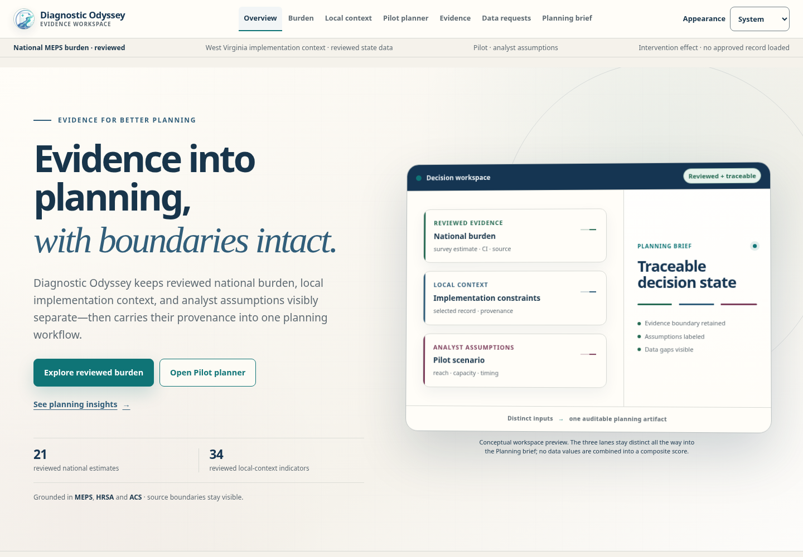
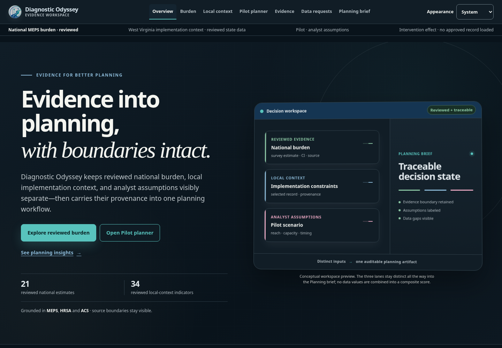

<div align="center">

# Diagnostic Odyssey

### Make hidden diagnostic burden visible. Turn reviewed evidence into a defensible plan.

<p>
  <strong>A statistically grounded decision workspace for service planning around Long COVID, ME/CFS, and other complex conditions.</strong>
</p>

<p>
  <a href="#quick-start">Quick start</a> ·
  <a href="#the-workflow">The workflow</a> ·
  <a href="#planning-intelligence-three-distinct-tools">Planning intelligence</a> ·
  <a href="#scientific-guardrails">Scientific guardrails</a> ·
  <a href="docs/architecture.md">Architecture</a>
</p>

<br>


</div>

<br>

> [!IMPORTANT]
> **Current evidence:** **21** reviewed national 2024 MEPS Long COVID estimates · **34** reviewed West Virginia state-level HRSA + ACS indicators · **2** descriptive Typical Ranges. These are separate evidence layers: local context never rescales national burden, and Typical Ranges are not intervention-effect estimates.



<details>
<summary>See the workspace in dark mode</summary>



</details>

## Why this exists

Complex-condition planning often fails at the handoff between evidence and action. Diagnostic Odyssey keeps those layers visible and separate:

| Evidence layer | Planning question |
| --- | --- |
| **Observed burden** | What does the reviewed national evidence say? |
| **Local context** | What implementation conditions are visible in the selected geography? |
| **Scenario assumptions** | What would a bounded pilot require under explicit assumptions? |
| **Operational requests** | What information would make the next decision stronger? |
| **Planning brief** | What can an analyst responsibly carry forward? |

The product is designed to help a team move from **“how large is the problem?”** to **“what could we test next?”** without turning assumptions into facts.

## At a glance

<table>
<tr>
<td width="50%" valign="top">

### Evidence you can inspect

- Reviewed national MEPS burden estimates
- Comparable confidence intervals where units and universes permit
- Reviewed West Virginia HRSA + 2024 ACS context
- Explicit release and admissibility states
- Provenance-aware planning artifacts

</td>
<td width="50%" valign="top">

### Decisions you can stress-test

- Deterministic reach and capacity scenarios
- Person-month exposure and program resources
- One-way sensitivity for reach, capacity, and recognition window
- Structured data-request handoff
- JSON export and browser print / save-PDF

</td>
</tr>
</table>

## The workflow

```text
┌──────────┐     ┌────────┐     ┌───────────────┐     ┌─────────────┐
│ Overview │ ──▶ │ Burden │ ──▶ │ Local Context │ ──▶ │ Pilot       │
└──────────┘     └────────┘     └───────────────┘     │ Planner     │
                                                      └──────┬──────┘
                                                             │
                              ┌──────────────────────────────┼────────────────┐
                              ▼                              ▼                ▼
                       ┌──────────────┐              ┌──────────────┐  ┌──────────┐
                       │ Data Requests│ ────────────▶ │ Planning     │  │ Evidence │
                       │ (opt-in)     │              │ Brief        │  │ review   │
                       └──────────────┘              └──────────────┘  └──────────┘
```

### Working vertical slice

**Burden → Pilot Planner → Data Requests → Planning Brief**

1. **Burden** — inspect domains, native units, release state, and reviewed intervals.
2. **Pilot Planner** — set assumptions, inspect decision visuals, and run one-way sensitivity.
3. **Data Requests** — optionally turn uncertainty into a structured operational request.
4. **Planning Brief** — review the assembled artifact and export its JSON companion or a PDF.

The analyst must explicitly opt in before a current data request enters the Planning Brief. Sensitivity testing is assumption testing, not evidence-derived effect estimation.

## Planning intelligence: three distinct tools

The integrated experience from [#110](https://github.com/Ianyliu/diagnostic-odyssey/pull/110) and [#112](https://github.com/Ianyliu/diagnostic-odyssey/pull/112) preserves the same canonical Brief across all three tools.

| Tool | Implemented behavior | Boundary |
| --- | --- | --- |
| **Planning Insights** | Deterministic summaries of the current Brief, readiness, gaps and traceable planning implications; an opt-in printed summary | No model inference, forecasts or causal estimates |
| **Analyze with AI** | Six analysis goals; preview, copy or download a complete Markdown handoff with canonical JSON; changed choices require explicit regeneration | The user transfers it to their own AI tool. The app calls no provider and consumes no tokens |
| **Future AI concept** | Four interactive demonstrations: explain a Brief, explore interventions, identify gaps and compare strategies | Illustrative, scientifically unadmitted content. Previewed capabilities are not implemented live research or inference |

When the concept is available, visitors can use **Show future AI concept** on the Brief or **Hide future AI concept** inside it. Hiding it preserves analyst state. Demonstrations never admit evidence or automatically change data requests.

### Build-time availability

Both optional surfaces are available unless their flag is exactly `off`. The user-operated AI handoff remains available in every combination.

| Build variable | Unset / `on` | `off` |
| --- | --- | --- |
| `VITE_PLANNING_INSIGHTS_PREVIEW` | Deterministic Insights and opt-in print summary | Insights hidden |
| `VITE_FUTURE_AI_EXPERIENCE_DEMO` | Concept route and visitor visibility controls | Concept chunk excluded; route returns to Brief |

```bash
# Example: build only the core workflow and user-operated handoff
VITE_PLANNING_INSIGHTS_PREVIEW=off VITE_FUTURE_AI_EXPERIENCE_DEMO=off npm run build
```

These public Vite flags are baked into the build; they are not secrets or live-AI switches. Building locally does not deploy anything. Hosting configuration and production release require separate review.

## Quick start

### Run locally

**Runtime:** Node.js **22** is the tested development/CI baseline (`engines` permits newer versions). R and Python are not needed to view the app.

```bash
npm ci
npm run dev
```

Open the local URL printed by Vite, usually [`http://localhost:5173`](http://localhost:5173). The app loads the promoted reviewed national MEPS artifact and the reviewed West Virginia context artifact as separate runtime layers. The checked-in illustrative fixture is for development and test coverage only.

### Run the checks

The full unit suite includes Python-backed JSON Schema agreement tests. Install Python 3 and activate a virtual environment so `python3` resolves to it:

```bash
python3 -m venv .venv
. .venv/bin/activate
python3 -m pip install jsonschema==4.26.0
```

```bash
npm run typecheck
npm test
npm run lint
npm run build
```

These commands cover TypeScript, the complete unit suite, ESLint and the production build. Schema subprocesses have a 15-second bound and report executable, timeout, exit and stderr diagnostics; a missing Python dependency is a failure, not a skipped test. Browser acceptance is separate: see [testing instructions](docs/testing.md) and the [audit verification matrix](docs/audit-2026-10-16/verification.md).

### Use the dev container

The optional VS Code dev container includes Node 22, R, analytical system libraries, recommended extensions, and port `5173` forwarding.

1. Install Docker and the [Dev Containers extension](https://marketplace.visualstudio.com/items?itemName=ms-vscode-remote.remote-containers).
2. Open the repository in VS Code.
3. Run **Dev Containers: Reopen in Container** from the Command Palette.
4. Run `npm run dev` in the container terminal.

The container is a convenience, not a requirement. Raw research data remains local and is never included in the image or committed to Git.

## Analytical pipeline

The offline MEPS pipeline requires R, the `haven`, `jsonlite`, `survey` and `testthat` packages, and official AHRQ data. Synthetic tests need no microdata:

```bash
Rscript analysis/r/install_dependencies.R
Rscript analysis/r/tests/run_tests.R
```

To generate a **preliminary** candidate locally:

```bash
Rscript analysis/r/install_dependencies.R
Rscript analysis/r/meps/run_meps_2024.R --download
```

Before running it, read [Data and analytical inputs](#data-and-analytical-inputs), [data/README.md](data/README.md), and [the source manifest](data/manifests/sources.json).

For maintenance or future regeneration, use the manual GitHub Actions workflow:

`Actions → MEPS 2024 Long COVID Candidate → Run workflow`

The workflow generates a **preliminary** candidate and uploads aggregate review files. It does not commit the candidate or change runtime artifact selection. If automatic download is unavailable, place the official HC-256 Stata ZIP at `data/raw/meps/2024/meps_hc256_2024_stata.zip` and run without `--download`.

## What is working

- Reviewed national 2024 MEPS HC-256 Long COVID artifact with **21 `reviewed_released` estimates**.
- Survey-aware MEPS analysis with reviewed variable maps, cohort construction, weight-specific survey designs, candidate generation, methods review, and promotion gates.
- Reviewed West Virginia **state-level** HRSA + 2024 ACS implementation context with fail-closed runtime validation.
- React + TypeScript + Vite application shell and major product routes.
- Versioned fixture loading, typed scientific contracts, and runtime validators.
- Deterministic scenario engine for reach, capacity, person-month exposure, and program-resource calculations.
- Capacity coverage/gap, recognition-window, and fixed-versus-participant-dependent resource visuals.
- Deterministic one-way sensitivity explorer with an accessible table alternative.
- Sensitivity-to-data-request handoff with explicit analyst opt-in and stale-request protection.
- Decision-state rail, reviewed confidence-interval visualization, and rural-status composition visualization.
- Planning Brief assembly, JSON companion export, and browser print / save-PDF path.
- Export filtering that excludes illustrative and unreleased estimates from released findings.
- Deterministic evidence admissibility gates and a Long COVID reference condition adapter.
- Coordinated opening/interaction motion, reduced-motion support, light/dark themes, keyboard navigation and responsive layouts.
- Deterministic Planning Insights, user-operated AI handoff and visitor-controlled Future AI demonstrations.
- GitHub Actions CI and production-browser regression suites.

## What is intentionally incomplete

The following boundaries are explicit rather than silently implied:

- Reviewed county-level context, county HRSA/ACS aggregation, topology, and the Implementation Decision Map.
- PLACES/CMS local-context ingestion.
- Reviewed external literature ledger and source extraction workflow.
- Evidence-backed bounded scenario parameters.
- Publication-grade, tagged accessible PDFs beyond browser print; richer provenance interaction.
- ME/CFS analytical estimates.
- Broader assistive-technology and cross-browser certification.
- Embedded grounded AI, autonomous literature acquisition, and provider integrations. No live AI service is implemented or required.

The checked-in artifact under `artifacts/examples/fixture-2026-09-v1/` is **illustrative development/test data only** and is deliberately barred from analytical export.

## Scientific guardrails

Diagnostic Odyssey preserves these distinctions:

- gross burden ≠ attributable burden;
- national burden evidence ≠ state/local implementation context;
- missing/suppressed ≠ zero;
- scenario assumptions ≠ observed effects;
- deterministic sensitivity testing ≠ evidence-derived effect estimation;
- scenario outputs ≠ forecasts;
- program-resource requirement ≠ savings or ROI;
- data requests are planning artifacts, not observed evidence;
- state/local context does not rescale national MEPS burden;
- PHQ-2/K6 screens ≠ psychiatric diagnoses;
- unreleased/suppressed values cannot enter exports;
- bounded effects can modify only the pathway step or mechanism they support.

Read the full [scientific guardrails](docs/scientific-guardrails.md) before interpreting or extending the analytical workflow.

## Visual QA

See the [current audit and before/after gallery](docs/audit-2026-10-16/README.md) for exact revisions, commands, results and limitations. Earlier QA records apply to their recorded revisions, not every later change.

## Repository map

```text
apps/
  web/                       React/Vite product shell and routes
packages/
  contracts/                 canonical types + runtime validators
  scenario-engine/           pure deterministic scenario calculations
  evidence-core/             reviewer/admissibility gates
  brief-core/                planning brief assembly + export filtering
  condition-adapters/        condition reuse boundary
  acquisition-hints/         governed acquisition guidance
  planning-guidance/         deterministic planning contracts
  narrative-references/      reviewed-reference contracts and provenance
  ui/                        design tokens
analysis/
  r/                         offline survey-analysis entry points
  local_context/             HRSA + ACS candidate pipeline/config/tests
pipelines/
  data/                       source acquisition helpers/boundaries
  evidence/                   evidence ingestion/review foundation
conditions/
  long-covid/                 reference implementation notes
  mecfs/                      compatibility proof notes
data/
  manifests/                 checked-in source inventory
  raw/                        local only; gitignored
  intermediate/               local only; gitignored
  derived/                    local only; gitignored
artifacts/
  reviewed/                   promoted aggregate artifacts used by runtime
  examples/                   illustrative development/test fixtures only
docs/
  architecture.md
  implementation-plan.md
  scientific-guardrails.md
  testing.md
```

## Data and working agreements

Do not commit raw public-use microdata, large intermediate files, or large generated analytical outputs. See [data/README.md](data/README.md) and [data/manifests/sources.json](data/manifests/sources.json) for required downloads, canonical filenames, official sources, size estimates, registration/API-key requirements, and script entry points.

- Keep raw microdata, intermediate files, and generated candidates out of Git.
- Treat missing, suppressed, and unreleased values as distinct from zero.
- Keep scenario assumptions separate from observed effects.
- Do not interpret program-resource requirements as savings or ROI.
- Run the quality checks before submitting changes.

## Documentation

| Guide | What it covers |
| --- | --- |
| [Architecture](docs/architecture.md) | Package boundaries and runtime flow |
| [Implementation plan](docs/implementation-plan.md) | Planned product and analytical work |
| [Scientific guardrails](docs/scientific-guardrails.md) | Interpretation and release constraints |
| [Testing](docs/testing.md) | Test strategy and validation boundaries |
| [MEPS Long COVID methods](docs/methods/meps-2024-long-covid.md) | Analytical method notes |

## AI boundary

There is **no embedded AI inference**, external provider request, API key or model-token consumption. The concept is an illustrative preview; the Markdown handoff is explicitly user-operated. Any future service must preserve deterministic arithmetic, human evidence admission and export eligibility gates. Literature demonstrations are not admitted reviewed evidence.
