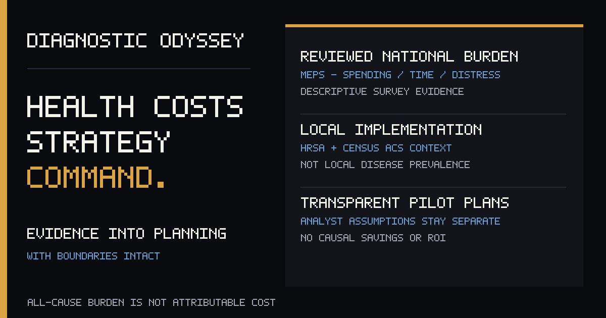

<div align="center">


# Diagnostic Odyssey

### See the burden. Find the leverage.

<p>
  <strong>Make hidden diagnostic burden visible. Turn reviewed evidence into a defensible plan.</strong><br>
  A statistically grounded <strong>Strategic Atlas (Edition 01)</strong> decision workspace for service planning around Long COVID, ME/CFS, and other complex conditions.
</p>

<p>
  <a href="#quick-start">Quick start</a> ·
  <a href="#design--brand-strategic-atlas">Design &amp; brand</a> ·
  <a href="#the-workflow">The workflow</a> ·
  <a href="#planning-intelligence--strategy-ai-studio">Strategy AI Studio</a> ·
  <a href="#scientific-guardrails">Scientific guardrails</a> ·
  <a href="docs/architecture.md">Architecture</a>
</p>

<br>


</div>

<br>

> [!IMPORTANT]
> **Current evidence (Edition 01):** **21** reviewed national 2024 MEPS Long COVID estimates across 3 populated domains (13 economic/healthcare, 4 administrative, 4 mental-health; Work & Function stays explicitly missing) · **34** reviewed West Virginia state-level HRSA + ACS indicators (no county-level data) · **2** descriptive Typical Ranges · **1** specialized documentation-linked secondary indicator (`Candidate A`, kept strictly separate on `/burden/medical`). These are separate evidence layers: local context never rescales national burden, and Typical Ranges are not intervention-effect estimates.

<div align="center">



<p><sub>Strategic Atlas Edition 01 share card rendered deterministically from <a href="scripts/og/render-og-image.mjs">scripts/og/render-og-image.mjs</a>. Historical pre-consolidation screenshots remain archived under <a href="docs/audit-2026-10-16/README.md">docs/audit-2026-10-16</a>.</sub></p>

</div>

## Why this exists

Complex-condition planning often fails at the handoff between evidence and action. Diagnostic Odyssey keeps those layers visible and separate:

| Evidence layer | Planning question |
| --- | --- |
| **Observed burden** | What does the reviewed national evidence say? |
| **Local context** | What implementation conditions are visible in the selected geography? |
| **Scenario assumptions** | What would a bounded pilot require under explicit assumptions? |
| **Operational requests** | What information would make the next decision stronger? |
| **Planning brief** | What can an analyst responsibly carry forward? |

The product is designed to help a team move from **“how large is the problem?”** to **“what could we test next?”** without turning assumptions into facts.

## Design & brand (Strategic Atlas)

The workspace uses the consolidated **Strategic Atlas** design system across light, dark, and print media:

- **Brand identity:** An astrolabe vector mark ([`diagnostic-odyssey-mark.svg`](apps/web/public/diagnostic-odyssey-mark.svg), [`diagnostic-odyssey-icon.png`](apps/web/public/diagnostic-odyssey-icon.png)) paired with the [`diagnostic-odyssey-horizontal.png`](apps/web/public/diagnostic-odyssey-horizontal.png) lockup and deterministic non-numeric [`og-image.png`](apps/web/public/og-image.png).
- **Cool-neutral & cobalt/violet palette:** Light porcelain canvas (`#F5F7FC`) and midnight navy ink (`#101B32`) paired with cobalt primary actions (`#3157D5`), evidence blue (`#2457A6`), and iris violet journey/assumption accents (`#7154D8`), plus an obsidian dark mode (`#0B1119` canvas, `#131C27` surface, `#91AAFF` accent, `#B8A5FF` journey/focus). Warm earth tones, terracotta, sage, teal, and dark green are excluded; green (`#0B6E38` light / `#4ADE80` dark / `#1ED760` dot) is reserved narrowly for positive statuses.
- **Self-hosted editorial typography:** `Newsreader Variable` for display headlines, `Plus Jakarta Sans Variable` for body copy and controls, and `IBM Plex Mono` for data/kickers with global `tabular-nums` and zero external font requests under strict CSP ([`vercel.json`](apps/web/vercel.json), [`theme-init.js`](apps/web/public/theme-init.js)).
- **7-role semantic grammar ("Grammar of Honesty"):** Reviewed evidence (solid evidence blue), local access context (slate-blue double-line border), pilot assumptions (45° diagonal hatching in iris violet), information gaps / optional data requests (dashed neutral border), warnings (plum), errors / capacity gaps (rose + hatching), and Strategy AI Studio (indigo dotted pill) always pair color with explicit labels and WCAG 2.1 AA contrast.
- **Six-chapter *Atlas Unfolded* landing & Edition 01 shell:** Opens with the porcelain *Care Horizon* artwork, sticky *Evidence Architecture* strata, inset Midnight Navy *From data to action* cartographic pathway, separated National/West Virginia lenses, live deterministic *Strategy Sandbox*, governed AI handoff preview, Planning Brief finale, and the header **Edition 01** Coverage & Roadmap drawer.

See the complete specification in [Design and motion](docs/design-and-motion.md).

## At a glance

<table>
<tr>
<td width="50%" valign="top">

### Evidence you can inspect

- Reviewed national MEPS burden estimates across `Focus` and `Overview` modes
- Comparable confidence intervals and descriptive Typical Ranges where universes permit
- Filterable 34-indicator statewide West Virginia HRSA + 2024 ACS constraint matrix with split provenance inspector and `DetailDrawer`
- Explicit release, admissibility, and Edition 01 coverage-roadmap states
- Provenance-aware planning artifacts and detached JSON/print metadata

</td>
<td width="50%" valign="top">

### Decisions you can stress-test

- Landing *Strategy Sandbox* and `03 Strategy Lab` presets (*Focused Clinic Pilot*, *Regional Navigation Program*, *High-Demand Stress Test*)
- Synchronized sliders, parameter bounds, deterministic *Compare Strategies* table, and rule-based Decision Inspector
- One-way sensitivity explorer with a deterministic *Capacity sufficiency threshold* curve
- Structured data-request handoff with **Known / Assumed / Unknown** framing
- `Known · Assumed · Unknown` Planning Brief executive memo, canonical JSON export, and browser print / save-PDF

</td>
</tr>
</table>

## The workflow

```text
┌──────────┐     ┌───────────┐     ┌──────────────────┐     ┌──────────────────┐     ┌───────────────────┐
│ Overview │ ──▶ │ 01 Burden │ ──▶ │ 02 Local context │ ──▶ │ 03 Strategy Lab  │ ──▶ │ 04 Planning Brief │
└──────────┘     └─────┬─────┘     └──────────────────┘     └────────┬─────────┘     └─────────┬─────────┘
                       │                                             │                           │
                       ▼                                             ┆ (optional)                ▼
                 ┌───────────┐                               ┌───────────────┐          ┌────────────────────┐
                 │ Evidence  │                               │ Data requests │ ────────▶│ Strategy AI Studio │
                 │  limits   │                               └───────────────┘          │ (optional/manual)  │
                 └───────────┘                                                          └────────────────────┘
```

### Working vertical slice

**01 Burden → 02 Local context → 03 Strategy Lab → 04 Planning Brief** (with optional **Data requests**)

1. **01 Burden** — inspect domains (economic/healthcare, administrative time, mental/human; Work & Function stays explicitly missing), native units, release state, and reviewed intervals in `Focus` or `Overview` mode with a split/drawer provenance inspector.
2. **02 Local context** — review the 34 statewide West Virginia HRSA and ACS indicators (no county-level data), filter by category, attach an indicator to Strategy Lab, or include records in the Brief.
3. **03 Strategy Lab** — choose a preset or set eight planning assumptions, review container-queried decision visuals and the rule-based Decision Inspector, compare scenarios deterministically in *Compare Strategies*, and run one-way sensitivity plus the capacity sufficiency threshold curve.
4. **Data requests (optional companion)** — turn sensitivity or capacity gaps into a structured request; new requests start included for the Brief (deselectable before export) and export only when current for the applied scenario.
5. **04 Planning Brief** — review the **Known · Assumed · Unknown** executive memo, assembled full report, optional deterministic *Planning Insights*, and export the canonical JSON companion or a print/PDF.

Sensitivity testing and scenario comparison are deterministic assumption testing, not evidence-derived effect estimation.

## Planning intelligence & Strategy AI Studio

Diagnostic Odyssey separates deterministic summaries, user-operated prompt handoffs, illustrative exploratory views, and isolated Preview-only Gemini operator testing across the same canonical `PlanningBrief`:

| Surface | Implemented behavior | Boundary |
| --- | --- | --- |
| **Planning Insights** | Deterministic summaries of the current Brief, readiness, gaps, and traceable planning implications; opt-in print summary | No model inference, forecasts, or causal estimates |
| **Prompt Studio & Analyze with AI** | Six analysis goals with complete v1 and opt-in concise goal-focused Markdown previews plus canonical JSON companion download (`Analyze with AI` modal on Brief or inline in Strategy AI Studio); changed inputs require explicit regeneration | User-operated handoff only; public builds call no provider and consume no tokens |
| **Illustrative exploration** | Four non-admitted interactive lenses inside **Strategy AI Studio** (`/advisor`, `/concept/future-ai`): explain a Brief, explore interventions, identify gaps, and compare strategies | Illustrative, scientifically unadmitted content; never admits evidence or mutates analyst state |
| **Authenticated preview guidance** | Protected `VERCEL_ENV=preview` operator lane (`POST /api/ai-guidance`) using bearer token, signed HMAC challenge (`AI_CHALLENGE_SECRET`), same-origin `Origin`, and Redis/KV rate & replay guards | Available only on authenticated Vercel Previews when enabled; returns `404` in public production (`/api/ai-preview` is permanently retired `404`) |

When Strategy AI Studio is enabled in the build, visitors can toggle **Show Strategy AI Studio** on the Planning Brief or select **Hide studio** inside the studio (preserving analyst state) and access it via the header `AI` pill or `/advisor` (`/concept/future-ai`).

### Build-time availability

Optional public surfaces are enabled unless their build flag is set to `off`. On-site Gemini preview guidance never ships in production builds (`VERCEL_ENV=preview` is required alongside `AI_PREVIEW_ENABLED=on` and `AI_GUIDANCE_ENABLED=on`).

| Build variable | Unset / `on` | `off` |
| --- | --- | --- |
| `VITE_PLANNING_INSIGHTS_PREVIEW` | Deterministic Insights and opt-in print summary | Insights hidden |
| `VITE_FUTURE_AI_EXPERIENCE_DEMO` | Strategy AI Studio routes (`/advisor`, `/concept/future-ai`) and visitor controls | Studio chunk excluded; routes return to Brief |

```bash
# Example: build only the core workflow and modal Analyze with AI handoff
VITE_PLANNING_INSIGHTS_PREVIEW=off VITE_FUTURE_AI_EXPERIENCE_DEMO=off npm run build
```

These `VITE_*` flags are public build-time switches baked into static assets; they are not secrets. See [Gemini preview setup](docs/gemini-preview-setup.md) and [Stage 2 Preview operator acceptance](docs/operations/stage2-gemini-reviewed-preview.md) for the Preview-only server configuration.

## Quick start

### Run locally

**Runtime:** Node.js **22** is the tested development/CI baseline (`engines` permits `>=22`). R and Python are not needed to view the app.

```bash
npm ci
npm run dev
```

Open the local URL printed by Vite, usually [`http://localhost:5173`](http://localhost:5173). The app loads the promoted reviewed national MEPS artifact and the reviewed West Virginia context artifact as separate runtime layers. The checked-in illustrative fixture is for development and test coverage only.

### Run the checks

The full unit suite includes Python-backed JSON Schema agreement tests. Install Python 3 and activate a virtual environment so `python3` resolves to it:

```bash
python3 -m venv .venv
. .venv/bin/activate
python3 -m pip install jsonschema==4.26.0
```

```bash
npm run typecheck
npm test
npm run lint
npm run build
```

These commands cover TypeScript, the complete unit suite (including WCAG 2.1 AA token contrast, Strategic Atlas layout/inventory, and CSP header contracts), ESLint, and the production Vite build (which runs `prebuild` to verify/regenerate `apps/web/public/og-image.png`). Schema subprocesses have a 15-second bound and report executable, timeout, exit, and stderr diagnostics; a missing Python dependency is a failure, not a skipped test. Browser acceptance is separate: see [testing instructions](docs/testing.md) and [browser tests](tests/browser/README.md).

### Use the dev container

The optional VS Code dev container includes Node 22, R, analytical system libraries, recommended extensions, and port `5173` forwarding.

1. Install Docker and the [Dev Containers extension](https://marketplace.visualstudio.com/items?itemName=ms-vscode-remote.remote-containers).
2. Open the repository in VS Code.
3. Run **Dev Containers: Reopen in Container** from the Command Palette.
4. Run `npm run dev` in the container terminal.

The container is a convenience, not a requirement. Raw research data remains local and is never included in the image or committed to Git.

## Analytical pipeline

The offline MEPS pipeline requires R, the `haven`, `jsonlite`, `survey` and `testthat` packages, and official AHRQ data. Synthetic tests need no microdata:

```bash
Rscript analysis/r/install_dependencies.R
Rscript analysis/r/tests/run_tests.R
```

To generate a **preliminary** candidate locally:

```bash
Rscript analysis/r/install_dependencies.R
Rscript analysis/r/meps/run_meps_2024.R --download
```

Before running it, read [Data and working agreements](#data-and-working-agreements), [data/README.md](data/README.md), and [the source manifest](data/manifests/sources.json).

For maintenance or future regeneration, use the manual GitHub Actions workflow:

`Actions → MEPS 2024 Long COVID Candidate → Run workflow`

The workflow generates a **preliminary** candidate and uploads aggregate review files. It does not commit the candidate or change runtime artifact selection. If automatic download is unavailable, place the official HC-256 Stata ZIP at `data/raw/meps/2024/meps_hc256_2024_stata.zip` and run without `--download`.

## What is working

- Reviewed national 2024 MEPS HC-256 Long COVID artifact with **21 `reviewed_released` estimates** across 3 populated domains (13 economic/healthcare, 4 administrative, 4 mental-health; Work & Function stays explicitly missing) and **2** descriptive Typical Ranges.
- Survey-aware MEPS analysis with reviewed variable maps, cohort construction, weight-specific survey designs, candidate generation, methods review, and promotion gates.
- Reviewed West Virginia **state-level** HRSA + 2024 ACS implementation context (**34** indicators) with fail-closed runtime validation and specialized linked-condition `Candidate A` presentation on `/burden/medical`.
- Consolidated **Strategic Atlas (Edition 01)** React + TypeScript + Vite shell: astrolabe brand marks, cool porcelain/obsidian & cobalt/violet token system, self-hosted fonts (`Newsreader Variable`, `Plus Jakarta Sans Variable`, `IBM Plex Mono`), strict CSP (`apps/web/vercel.json` + `/theme-init.js`), and WCAG 2.1 AA contrast tests.
- Six-chapter *Atlas Unfolded* landing experience (`Care Horizon`, sticky *Evidence Architecture* strata, sweeping 1024×380 *From data to action* pathway, separated lenses, live deterministic *Strategy Sandbox*, and governed AI demo) with independent reduced-motion and interruptible choreography.
- `01 Burden` and `02 Local context` ledgers with `Focus`/`Overview` presentation modes, split provenance inspector, accessible `DetailDrawer`, `EditionDrawer` coverage roadmap, and explicit **Use in Strategy Lab** selection.
- `03 Strategy Lab` split studio with 3 presets, synchronized sliders, container-queried decision visuals, rule-based contextual Decision Inspector, deterministic *Compare Strategies* table, one-way sensitivity explorer, and *Capacity sufficiency threshold* curve.
- `Data requests` companion with **Known / Assumed / Unknown** epistemic strip, exact applied inputs, owner confirmation checklist, explicit analyst opt-in, and stale-request protection.
- `04 Planning Brief` with always-visible **Known · Assumed · Unknown** executive decision memo, opt-in local-context print appendix, canonical JSON companion export, and browser print / save-PDF path.
- Deterministic *Planning Insights*, user-operated *Prompt Studio / Analyze with AI*, illustrative four-lens exploration in *Strategy AI Studio*, and hardened Preview-only `/api/ai-guidance` (disabled in public production).
- GitHub Actions CI and production-browser, accessibility, opening-circuit, security-header, and fail-closed PDF/JSON regression suites.

## What is intentionally incomplete

The following boundaries are explicit rather than silently implied:

- Reviewed county-level context, county HRSA/ACS aggregation, topology, and the Implementation Decision Map.
- PLACES/CMS local-context ingestion.
- Reviewed external literature ledger (`narrative-references` and `acquisition-hints` release allowlists remain empty in production) and evidence-backed bounded scenario parameters.
- Publication-grade, tagged accessible PDFs beyond browser print; saved/versioned multi-scenario comparison storage.
- ME/CFS analytical estimates (`Partial compatibility` roadmap module only; no Long COVID borrowing).
- Broader assistive-technology and cross-browser certification beyond Chromium/axe automated suites.
- Public live AI inference and autonomous literature retrieval (zero live AI runs in public production builds; `/api/ai-guidance` is restricted to isolated authenticated Vercel Previews).

The checked-in artifact under `artifacts/examples/fixture-2026-09-v1/` is **illustrative development/test data only** and is deliberately barred from analytical export.

## Scientific guardrails

Diagnostic Odyssey preserves these distinctions:

- gross burden ≠ attributable burden;
- national burden evidence ≠ state/local implementation context;
- missing/suppressed ≠ zero;
- scenario assumptions ≠ observed effects;
- deterministic sensitivity testing ≠ evidence-derived effect estimation;
- scenario outputs ≠ forecasts;
- program-resource requirement ≠ savings or ROI;
- data requests are planning artifacts, not observed evidence;
- state/local context does not rescale national MEPS burden;
- PHQ-2/K6 screens ≠ psychiatric diagnoses;
- unreleased/suppressed values cannot enter exports;
- bounded effects can modify only the pathway step or mechanism they support.

Read the full [scientific guardrails](docs/scientific-guardrails.md) before interpreting or extending the analytical workflow.

## Visual QA & design documentation

- [Design and motion](docs/design-and-motion.md) — Strategic Atlas brand identity, light/dark/print tokens, 7-role semantic grammar, typography, layout conventions, and motion contract.
- [Testing and validation strategy](docs/testing.md) — unit, WCAG contrast, opening-circuit, guided-workspace, security-header, and Workstream H PDF/JSON verification.
- [Strategic Atlas consolidation handoff](docs/design-experiments/strategic-atlas-consolidation-20261123.md) — consolidation architecture merged in PR #150.
- [October 16, 2026 audit & screenshots](docs/audit-2026-10-16/README.md) — historical pre-Strategic Atlas QA archive (applies to its recorded revision only).

## Repository map

```text
apps/
  web/                       React/Vite Strategic Atlas shell, routes, and brand assets
    api/                     Vercel serverless handlers (Preview-only ai-guidance; retired 404 ai-preview)
packages/
  contracts/                 canonical types + runtime validators
  scenario-engine/           pure deterministic scenario calculations
  evidence-core/             reviewer/admissibility gates
  brief-core/                planning brief assembly + export filtering
  condition-adapters/        condition reuse boundary
  acquisition-hints/         governed acquisition guidance contracts
  planning-guidance/         deterministic planning-guidance contracts
  narrative-references/      reviewed-reference contracts and provenance
  ui/                        Strategic Atlas design tokens (light/dark/print CSS variables)
analysis/
  r/                         offline survey-analysis entry points
  local_context/             HRSA + ACS candidate pipeline/config/tests
pipelines/
  data/                      source acquisition helpers/boundaries
  evidence/                  evidence ingestion/review foundation
conditions/
  long-covid/                Edition 01 reference implementation notes
  mecfs/                     partial compatibility notes
data/
  manifests/                 checked-in source inventory
  raw/                       local only; gitignored
  intermediate/              local only; gitignored
  derived/                   local only; gitignored
artifacts/
  reviewed/                  promoted aggregate artifacts used by runtime
  examples/                  illustrative development/test fixtures only
docs/                        documentation index, design spec, architecture, methods, and QA archives
scripts/
  og/                        deterministic non-numeric og-image.png renderer
  maintenance/               governed regression snapshot/comparison tools
tests/
  browser/                   Playwright + axe + PDF browser acceptance suites
```

## Data and working agreements

Do not commit raw public-use microdata, large intermediate files, or large generated analytical outputs. See [data/README.md](data/README.md) and [data/manifests/sources.json](data/manifests/sources.json) for required downloads, canonical filenames, official sources, size estimates, registration/API-key requirements, and script entry points.

- Keep raw microdata, intermediate files, and generated candidates out of Git.
- Treat missing, suppressed, and unreleased values as distinct from zero.
- Keep scenario assumptions separate from observed effects.
- Do not interpret program-resource requirements as savings or ROI.
- Run the quality checks before submitting changes.

## Documentation

Browse the full [documentation index](docs/README.md) or jump directly to:

| Guide | What it covers |
| --- | --- |
| [Design and motion](docs/design-and-motion.md) | Strategic Atlas palette, typography, brand assets, semantic grammar, and motion |
| [Architecture](docs/architecture.md) | Package boundaries, routing, CSP shell, and runtime flow |
| [Scientific guardrails](docs/scientific-guardrails.md) | Interpretation and release constraints |
| [Testing](docs/testing.md) | Unit, contrast, browser, PDF, and security validation |
| [Implementation plan](docs/implementation-plan.md) | Delivery phases and current Edition 01 status |
| [MEPS Long COVID methods](docs/methods/meps-2024-long-covid.md) | Analytical method notes |
| [Gemini Preview setup](docs/gemini-preview-setup.md) | Retired `/api/ai-preview` and Preview-only `/api/ai-guidance` overview |

## AI boundary

Public production builds contain **zero embedded AI inference**, external provider calls, API keys, or token consumption: *Prompt Studio* (`Analyze with AI`) prepares a frozen, user-operated Markdown/JSON handoff locally, and *Illustrative exploration* displays clearly labeled unadmitted concept views. The authenticated `/api/ai-guidance` endpoint is active **only** in protected `VERCEL_ENV=preview` deployments with explicit operator credentials and fails closed (`404`) in public production; `/api/ai-preview` is permanently retired (`404`). Any future production AI capability must preserve deterministic arithmetic, human evidence admission, and export eligibility gates.
