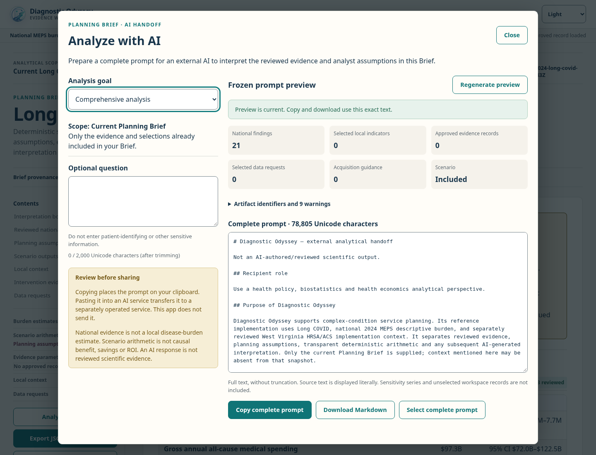
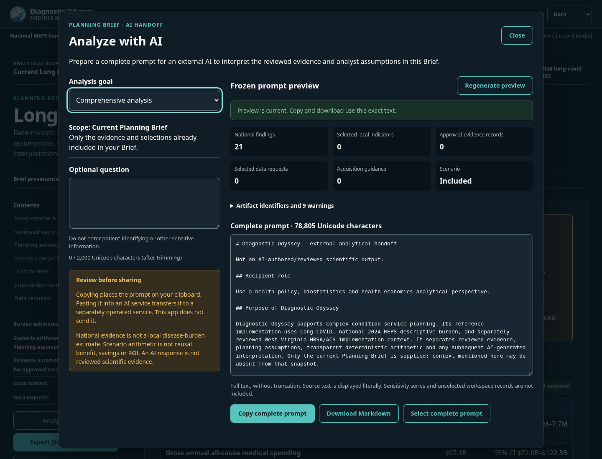
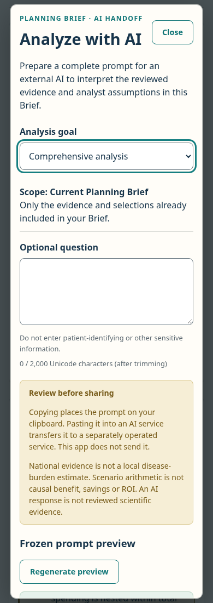
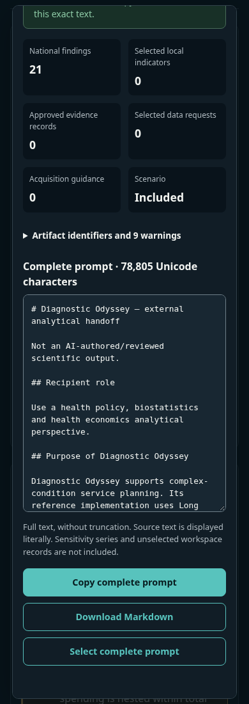

# Analyze with AI — PR B

The Planning Brief now offers **Analyze with AI**: a complete, frozen prompt with
six analytical goals, a current-Brief-only scope, an optional question, provenance,
scientific/privacy warnings, clipboard copying and Markdown download. Comprehensive
analysis is the default. The question limit is 2,000 Unicode code points after
trimming, matching the existing core; overlong text is rejected, never shortened.

The starting point is merged PR #107 at
`a3a94acfcfc4c0ef004d719e355f433f331b191c`; its post-merge CI run
[38735578803](https://github.com/Ianyliu/diagnostic-odyssey/actions/runs/38735578803)
passed. PR #105 remained open and unmerged at
`c176e8843780039661cc1439ab56da6cb69a059f`. Its presentation changes are not a
dependency and were not imported. The PR description records the final exact head,
validation runs, screenshots and independent review status.

## Source and export contract

`BriefPage` passes the same `brief` object used by Export JSON companion to
`AiHandoff`. No composition refactor or second raw-artifact assembly was needed.
The merged `aiHandoff.ts`, templates, canonical serializer, scientific contracts,
scenario formulas, reviewed artifacts and numerical outputs are unchanged.

Opening the dialog generates a detached, deeply frozen preview. Goal/question
changes and meaningful source changes latch it stale, including a change followed
by a return to the original values. **Regenerate preview** is the only way to make
that session current again. Closing discards the session; reopening creates a new
preview with the defaults. No handoff content or options are persisted.

Identity compares the validated canonical payload plus applied scenario, artifact
readiness/version, selected local IDs, Pilot local ID and included request IDs.
Only the top-level composition `generated_at` is excluded; nested provenance and
all scientific values, warning text and selections remain significant. Unselected
requests do not change current-Brief scope. The original snapshot timestamp stays
fixed until regeneration. Source checks do not enrich or independently reconstruct
the payload.

An unavailable national or local artifact, invalid applied scenario or failed
handoff validation disables generation and transfers with an explanation. This is
conservative even when a national-only Brief could still be exported normally.
Existing JSON/print controls remain independent. A previously valid frozen preview
can remain visible for inspection, but stale copy, download and selection actions
stay disabled until recovery and explicit regeneration.

## Browser behavior and boundaries

- The native modal dialog has an accessible name and description, initial focus,
  Tab/Shift+Tab wrapping, Escape dismissal and focus restoration. Responsive
  layouts use existing semantic design tokens in both themes.
- Prompt and question contents use textareas; provenance/warnings use React text
  nodes. No source Markdown/HTML is interpreted as active markup.
- Clipboard writes require a current preview and an explicit click. Success is
  announced only after the promise resolves. Denied, unsupported and insecure
  contexts offer full manual selection and Markdown download. A pending copy whose
  source changes reports that the clipboard may contain the older preview; browser
  writes already in progress cannot be cancelled. Closing a session prevents its
  pending result from announcing success in a new dialog.
- Markdown uses the exact frozen string in a UTF-8 Blob with a sanitized, bounded
  artifact/goal/date filename. No BOM, truncation or payload rewriting is added.
  Temporary object URLs are released. A download failure offers manual selection.
- No AI API, provider credentials, provider URLs, provider launch, prefill,
  automatic submission, prompt telemetry or handoff persistence is introduced.
  Source locators remain inert source text. The app performs no provider transfer;
  the privacy notice explains what happens when a user pastes into another service.
- The dialog and backdrop are excluded from print. Existing Brief disclosure and
  PDF behavior is unchanged, including when printing with the dialog open.

## Verification and independent review

Use Node 22.23.3/npm 10.9.9 and run `npm ci`, `npm run typecheck`, `npm test`,
`npm run lint`, and `npm run build`. The workspace suite includes source-identity,
readiness/release rejection, Unicode, clipboard promise/failure and filename tests,
alongside all merged core/template regressions.

Serve the production build on port 4186. Use the existing isolated Playwright
1.64.0/axe-core 4.11.1 runner, and serve the **test-only** fault fixture separately:

```sh
./node_modules/.bin/vite --config tests/browser/ai-handoff-fixture/vite.config.mjs
QA_BASE_URL=http://127.0.0.1:4186 QA_AI_FIXTURE_URL=http://127.0.0.1:4197 \
  QA_OUTPUT=/tmp/ai-handoff-browser node tests/browser/ai-handoff.mjs
```

The suite checks all six goals and complete canonical payload/copy/download parity,
Unicode boundaries, hostile question/source text, release filtering and constructed
record rejection, real ArtifactContext scenario/local/Pilot/request changes,
timestamp-only recomposition, unavailable/invalid states, native and simulated
clipboard paths, delayed-copy races, download failure, keyboard focus, accessible
dialog semantics, axe, 390/768/1440-pixel layouts, both themes, no handoff storage
changes, zero unexpected external requests, and open/closed-dialog PDF capture.
Fault controls exist only in the isolated fixture entry point.

Also run full `acceptance.mjs`, `gate0-accessibility.mjs` and
`acquisition-hints.mjs` with its existing prepared fixture, plus offline Python/R
tests and reviewed SHA256SUMS checks. Compare the pinned base and final acceptance
outputs using `tests/browser/compare-results.mjs`; all seven governed snapshots
must match, ignoring only Brief generation timestamps. Compare default and workflow
PDF page text using `pdftotext -layout`, replacing only each captured Brief's exact
generation timestamp. Open versus closed dialog PDF text must match without any
normalization. Built UI assets necessarily change; source artifacts must not.

The **AI Handoff Exact Head** workflow explicitly checks out and verifies the PR
head SHA, runs Node 22 checks and the complete acceptance/accessibility/handoff
suites, and retains revision-labeled evidence. Independent scientific, export,
privacy and accessibility review is requested separately from test success. Jules'
verdict must apply to the final SHA; a prior-head or merge-ref pass is insufficient.

Limitations: browser execution covers Chromium, not Safari/Firefox or native print
dialogs. Axe and accessibility-tree/keyboard checks do not certify screen-reader
speech or tagged PDF accessibility; human assistive-technology review remains
needed. External model behavior and provider transport are deliberately untested.
Core limitations on source authentication and prompt-injection resistance remain
as documented for PR A. The existing Vite chunk-size warning remains.

## Screenshots

| Desktop light | Desktop dark |
| --- | --- |
|  |  |

| Mobile light | Mobile dark preview |
| --- | --- |
|  |  |

## Separately authorized PR C

The planned provider stage covers ChatGPT, Claude, Gemini and Perplexity. Each
provider must support an explicit **Copy & Open** path. Automatic prefill is allowed
only after its mechanism and complete payload-size handling have been verified;
unsupported or oversized payloads must use complete copy/download. No automatic
submission or silent truncation is allowed. Provider URLs, consent, transmission,
encoding/size behavior and browser compatibility require separate review and
explicit approval before implementation.

This PR does not merge, deploy, synchronize static branches or modify the October
15 submission artifacts. Rollback reverts the additive UI/session/transfer changes
and their tests; it requires no data migration and leaves the merged PR A core.
