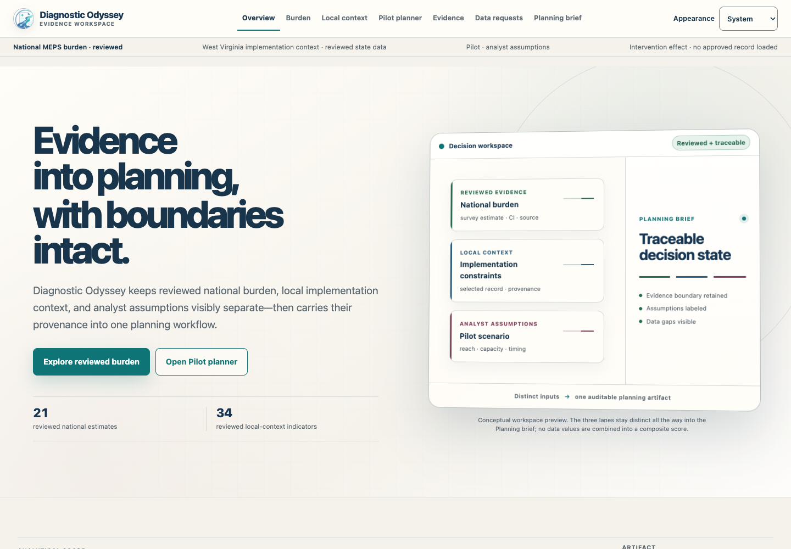
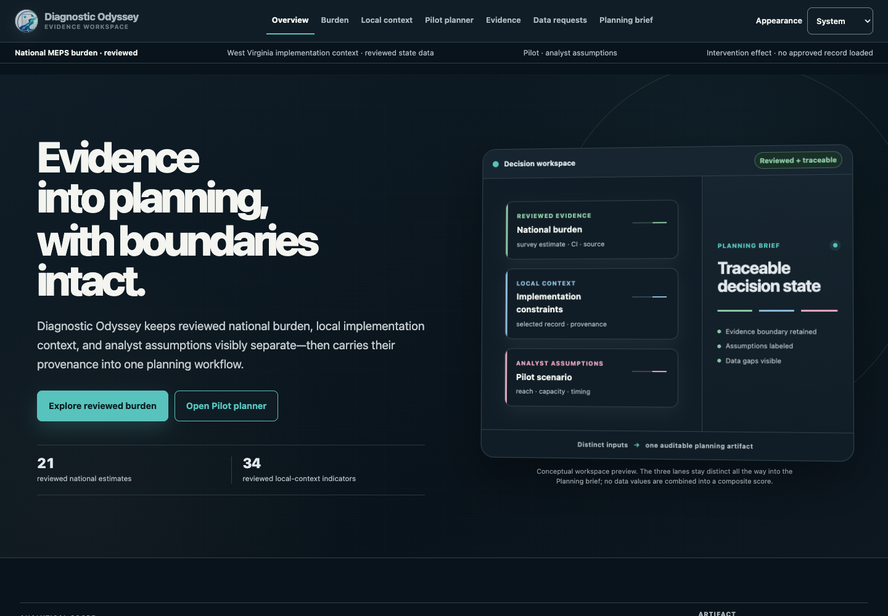
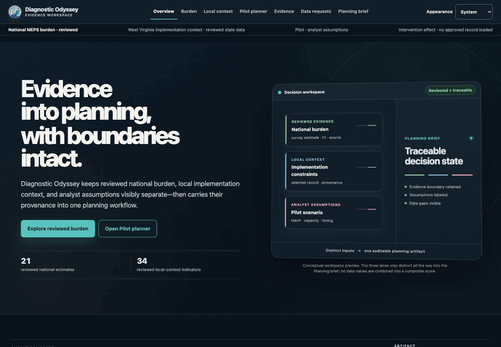
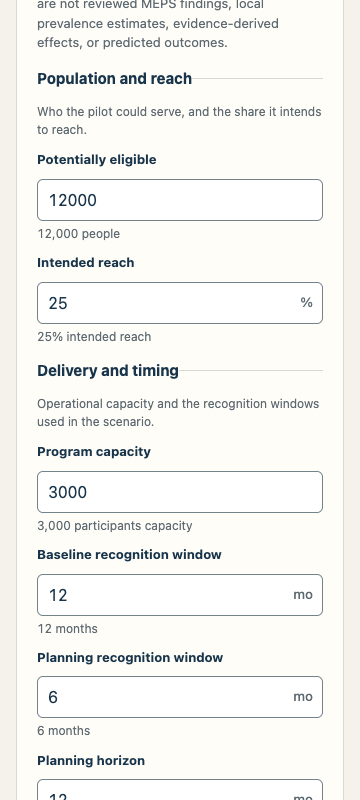
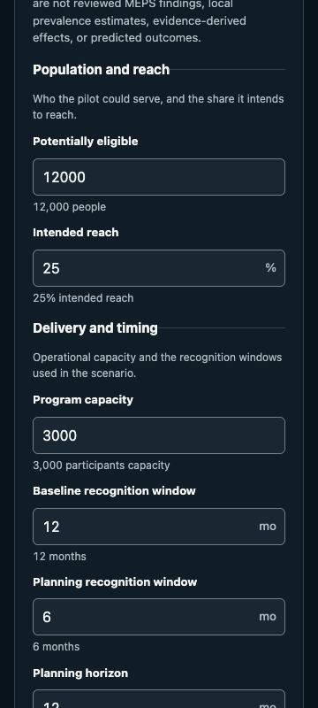
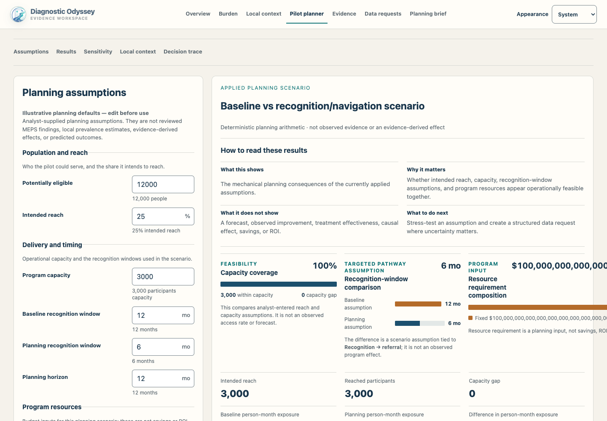
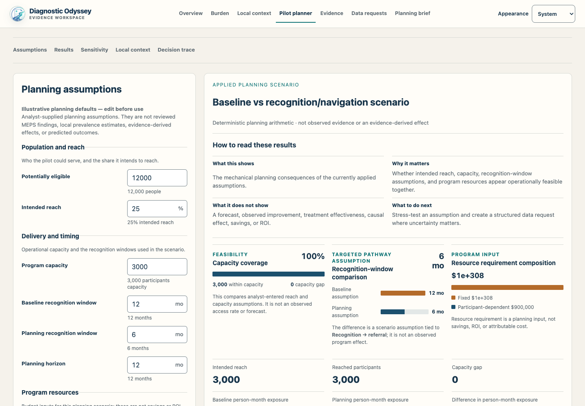

# Diagnostic Odyssey submission maintenance audit

October 10, 2026. This report records engineering repairs, scientific-preservation evidence, historical dispositions, and remaining release work. The maintenance baseline is [`b99d1c7`](https://github.com/Ianyliu/diagnostic-odyssey/commit/b99d1c703226009f2004a06a332174124fbfd8a3). Final repaired application source is [`d578be2`](https://github.com/Ianyliu/diagnostic-odyssey/commit/d578be2df7ce5ccce3facc32b533d9b574ac4bdb), the PR91 merge. Its exact reviewed head [`d604fb5`](https://github.com/Ianyliu/diagnostic-odyssey/commit/d604fb5ef7e12ebc64e2d11cb44d2d0b63498c88) passed [application and R CI](https://github.com/Ianyliu/diagnostic-odyssey/actions/runs/38084611863), independent source review, and the refreshed full rendered-browser matrix. This documentation PR follows the code repairs; the subsequent exact build/main/static/deployment identifiers belong in release provenance to avoid a self-referential commit hash.

**Engineering outcome:** numerical validation, browser reliability, reproducible dependencies, targeted accessibility/print fixes, and independent verification are complete for the repaired source. All 284 JavaScript tests, 51 Python tests, 829 R assertions, 24 rendered-browser groups, and exact governed comparisons pass. Visual review found and repaired a scientific-notation token split that document-width assertions missed; direct text-Range containment regressions now pass. Final clean static rebuild and actual live deployment verification remain separate release steps. Two moderate dependency package findings, missing enforced main protections, and explicitly deferred housekeeping remain documented below.

## Findings, repairs, and validation

Severity describes the engineering impact: P1 can invalidate planning output or prevent the demonstrated workflow; P2 affects integrity, reliability, accessibility, or review coverage; P3 is lower-risk maintenance/polish. Dependency advisory severity is reported separately.

| Finding / severity | Root cause | Implemented repair | Validation and PR |
|---|---|---|---|
| Reproducible dependency installation and high advisory — P2 | No tracked root lockfile; preserved untracked lock resolved Vite7/8 and Router7 contrary to current declared Vite6/Router6 ranges | Resolve within existing manifests on Node22; commit lock; use `npm ci`; source-map-js1.2.2 fixes high advisory | Clean install of 186 packages; typecheck/tests/lint/build; audit high0/critical0; [PR78](https://github.com/Ianyliu/diagnostic-odyssey/pull/78) |
| Extreme numeric drafts / results — P1 | Unbounded exponent expansion, nonzero underflow, finite inputs whose arithmetic overflows, JSON's silent nonfinite-to-null conversion | Bound parsing/decimal shifting; reject invalid representation/result; preserve last applied scenario; reject nonfinite Brief serialization while retaining legitimate scientific nulls | Draft/contract/scenario/Brief tests, browser invalid-draft and actual-download checks; [PR80](https://github.com/Ianyliu/diagnostic-odyssey/pull/80) |
| Huge valid values overflow layout — P2 | Locale formatting expands finite values such as 1e308 into hundreds of characters | At magnitude ≥1e12, use bounded round-trippable scientific notation; preserve ordinary caller precision; add wrapping | 284 unit tests; extreme Pilot/Brief cases at three widths in both themes, including 1e308 and maximum finite cost/reached counts; exact exported input/output checks; [PR90](https://github.com/Ianyliu/diagnostic-odyssey/pull/90), merged; [PR91](https://github.com/Ianyliu/diagnostic-odyssey/pull/91) token-split repair verified and merged |
| Browser media API failures — P1 | Theme/opening/print consumers assumed complete, callable `matchMedia` and subscription APIs | Guard calls/getters, support modern/legacy paired cleanup, tolerate missing/throwing/partial implementations | Unit fault cases; rendered missing/incomplete/throwing APIs and listener cleanup; [PR84](https://github.com/Ianyliu/diagnostic-odyssey/pull/84) |
| Asynchronous print state and pagination — P2 | Print can return before dialog ends; disclosure restoration and page breaks could separate decision labels/explanations | Keep prepared details until afterprint/print-media restoration; restore on thrown print; adjust print grouping and table/pagination behavior | Print tests; actual 8-page Letter PDF and visual page review; [PR75](https://github.com/Ianyliu/diagnostic-odyssey/pull/75), [PR83](https://github.com/Ianyliu/diagnostic-odyssey/pull/83) |
| Contrast / unnamed semantic containers — P2 | Brand/workflow colors and generic containers with labels produced accessibility findings | Repair light/dark contrast; give named planning/evidence containers group semantics | Axe across all 11 routes in both themes; keyboard/visual review; [PR82](https://github.com/Ianyliu/diagnostic-odyssey/pull/82), [PR88](https://github.com/Ianyliu/diagnostic-odyssey/pull/88) |
| Portable candidate verification / incomplete hash coverage — P2 | Bash4/GNU-only tools fail on default macOS; ordinary checksum verification permits a truncated manifest | Python stdlib exact regular-file set, no symlinks/subdirectories, credential exclusion, exactly one hash per expected payload; preserve executable entrypoints | Actual Bash3.2 regression cases include FIFO, hidden entries, traversal, duplicate/incomplete hashes and leaked keys; [PR85](https://github.com/Ianyliu/diagnostic-odyssey/pull/85), [PR89](https://github.com/Ianyliu/diagnostic-odyssey/pull/89) |
| ACS metadata latency and failure/configuration boundaries — P2 | Sequential independent requests; initial bot change needed whole-configuration validation and bounded scheduling | Validate all required IDs before network; deduplicate in configured order; at most 4 workers; propagate failures without partial return; retain exact downstream metadata checks | Python51 tests, identity/order/configuration/concurrency/failure cases; [PR76](https://github.com/Ianyliu/diagnostic-odyssey/pull/76) |
| Thin evidence and Brief boundary coverage — P2 | Several existing correct gates/warnings lacked branch-complete regressions | Evidence tests2→18; final Brief suite14; portable governed capture/comparison | Reviewer/admissibility/step/mechanism branches; nested spending, screening/ESAQ warnings; exact regression deliberately rejects tampering; [PR86](https://github.com/Ianyliu/diagnostic-odyssey/pull/86) |
| Browser/error-path acceptance gap — P2 | Static checks alone did not verify production route navigation, actual downloads, failures, print, or keyboard workflow | Retain focused fragment/storage/runtime-loader/opening/print tests; add rendered acceptance runner and baseline comparator | 24 rendered checks PASS; fail-closed national/local artifact states; keyboard-only selection/export; [PR70](https://github.com/Ianyliu/diagnostic-odyssey/pull/70), [PR71](https://github.com/Ianyliu/diagnostic-odyssey/pull/71), [PR73](https://github.com/Ianyliu/diagnostic-odyssey/pull/73), [PR74](https://github.com/Ianyliu/diagnostic-odyssey/pull/74), [PR87](https://github.com/Ianyliu/diagnostic-odyssey/pull/87) |
| Workflow supply-chain reproducibility — P2 | Mutable action tags and implicit reviewer-workflow defaults | Pin existing action versions to full commits; explicit contents:read default; bounded Jules job timeout; retain only required job permissions | All 20 external action uses in 6 workflows pinned; no action major upgrades or expanded permissions; [PR81](https://github.com/Ianyliu/diagnostic-odyssey/pull/81) |

## Atomic implementation inventory

PR links retain discussion/check/review history; commit links identify the substantive implementation or cleanup. Original bot commits and remote branches were preserved. Multi-commit rows show the relevant repair rather than treating a merge commit as an atomic implementation.

| PR / state at authoring | Scope | Atomic commit(s) |
|---|---|---|
| [78](https://github.com/Ianyliu/diagnostic-odyssey/pull/78), merged | Lock/dependency repair; clean-install CI/docs | [33cd0af](https://github.com/Ianyliu/diagnostic-odyssey/commit/33cd0af78bff11c52e137ac34fdd3bfe920c8ae1), [c745f98](https://github.com/Ianyliu/diagnostic-odyssey/commit/c745f98e61ef1df6ba93a7b76ef6eec6ab01db16) |
| [70](https://github.com/Ianyliu/diagnostic-odyssey/pull/70), merged | Malformed-fragment behavior tests | [9bf46a4](https://github.com/Ianyliu/diagnostic-odyssey/commit/9bf46a4fb8836587a5a10edd2784da9582b09bcd) |
| [71](https://github.com/Ianyliu/diagnostic-odyssey/pull/71), merged | Trusted loader seam and fail-closed error test | [bdc7b05](https://github.com/Ianyliu/diagnostic-odyssey/commit/bdc7b059d7de69b9a450a46625f722e4e274721e) |
| [80](https://github.com/Ianyliu/diagnostic-odyssey/pull/80), merged | Numerical and serialization boundaries | [b2134c4](https://github.com/Ianyliu/diagnostic-odyssey/commit/b2134c4b136d598868dcfb0e8b8b62d92e495aa7) |
| [73](https://github.com/Ianyliu/diagnostic-odyssey/pull/73), merged | Storage tests and complete global-descriptor restoration | [399df62](https://github.com/Ianyliu/diagnostic-odyssey/commit/399df627f3122722156810b346dd6a4e78715f63), [6f1c568](https://github.com/Ianyliu/diagnostic-odyssey/commit/6f1c5681b3040e7e5996c65a98425c9c9b8eabf5) |
| [75](https://github.com/Ianyliu/diagnostic-odyssey/pull/75), merged | Print error test and asynchronous restoration | [19134bc](https://github.com/Ianyliu/diagnostic-odyssey/commit/19134bce4e1a74aaa5fec73273da172a0301efd3), [d5d0e79](https://github.com/Ianyliu/diagnostic-odyssey/commit/d5d0e79f460be0c70e3f417ef277b4d41db010ae) |
| [76](https://github.com/Ianyliu/diagnostic-odyssey/pull/76), merged | Concurrent ACS fetch, validation, cleanup, reviewed guards | [718da97](https://github.com/Ianyliu/diagnostic-odyssey/commit/718da97366fec79e45cd1cd007032bd897f7b6da), [372a197](https://github.com/Ianyliu/diagnostic-odyssey/commit/372a197dc302a547b806ce46884e3c91bb2f8fcd), [16e6823](https://github.com/Ianyliu/diagnostic-odyssey/commit/16e6823751f7a9e65c3d4da339e89dfa530cc5fe) |
| [81](https://github.com/Ianyliu/diagnostic-odyssey/pull/81), merged | Pinned Actions and security documentation | [15e6bb2](https://github.com/Ianyliu/diagnostic-odyssey/commit/15e6bb2f7de0d073661494bec72d6bf0d169604d) |
| [74](https://github.com/Ianyliu/diagnostic-odyssey/pull/74), merged | Opening media-query test/guards and integration resolution | [8129336](https://github.com/Ianyliu/diagnostic-odyssey/commit/812933662421ffd1cd6660679502a38c16d81c8e), [7e2871f](https://github.com/Ianyliu/diagnostic-odyssey/commit/7e2871fad7994a4fc12d42a96f65146c1878ecf2) |
| [82](https://github.com/Ianyliu/diagnostic-odyssey/pull/82), merged | Contrast | [b0c204a](https://github.com/Ianyliu/diagnostic-odyssey/commit/b0c204a81758f1b584f71713633cf811f480f162) |
| [83](https://github.com/Ianyliu/diagnostic-odyssey/pull/83), merged | Print pagination | [240983f](https://github.com/Ianyliu/diagnostic-odyssey/commit/240983fce3aac1bd698c81b0249c57d8a86d9622) |
| [84](https://github.com/Ianyliu/diagnostic-odyssey/pull/84), merged | Browser media fallbacks | [4d783a2](https://github.com/Ianyliu/diagnostic-odyssey/commit/4d783a2ccc52daaec52384efb2f0ad8ae02fcc98) |
| [85](https://github.com/Ianyliu/diagnostic-odyssey/pull/85), merged | Portable strict verifier | [ac18720](https://github.com/Ianyliu/diagnostic-odyssey/commit/ac187201f7de5d0c692c61325654c9fea36a4a6c) |
| [86](https://github.com/Ianyliu/diagnostic-odyssey/pull/86), merged | Evidence/Brief tests and exact regression tools | [fe24ab4](https://github.com/Ianyliu/diagnostic-odyssey/commit/fe24ab40d265e2a3e5fecf194aed09ea1597de6a) |
| [87](https://github.com/Ianyliu/diagnostic-odyssey/pull/87), merged | Rendered acceptance runner | [2ece0d4](https://github.com/Ianyliu/diagnostic-odyssey/commit/2ece0d4ac6a57a7987eb1e7d3cfb8f8fb73b7f8b) |
| [88](https://github.com/Ianyliu/diagnostic-odyssey/pull/88), merged | Named accessibility groups | [5de5cc6](https://github.com/Ianyliu/diagnostic-odyssey/commit/5de5cc625ad61b3d3bfd30414e65b597e31d72f0) |
| [89](https://github.com/Ianyliu/diagnostic-odyssey/pull/89), merged | Python ignores and shell executable modes | [148843f](https://github.com/Ianyliu/diagnostic-odyssey/commit/148843f3e4b224545f96631efb6df21cd2f3182f) |
| [90](https://github.com/Ianyliu/diagnostic-odyssey/pull/90), merged | Huge-value presentation and stronger browser export/layout checks | [6eba725](https://github.com/Ianyliu/diagnostic-odyssey/commit/6eba7255fab86414985dcd183b8acf27e2429335), [5d3425b](https://github.com/Ianyliu/diagnostic-odyssey/commit/5d3425bb6755de049bd95b8b123ea0f3bb6026b6) |
| [91](https://github.com/Ianyliu/diagnostic-odyssey/pull/91), merged | Keep complete scientific tokens together; direct rendered text-range regression | [29e2f5d](https://github.com/Ianyliu/diagnostic-odyssey/commit/29e2f5dc425b864f2264410aba2b1ab841e22bed), [d604fb5](https://github.com/Ianyliu/diagnostic-odyssey/commit/d604fb5ef7e12ebc64e2d11cb44d2d0b63498c88) |

## Scientific preservation and exact regression evidence

No maintenance repair acquired new scientific data, rewrote reviewed artifacts, changed estimators/precision policy, admitted new evidence, or changed the national/local boundary. The national runtime retains 21 reviewed estimates; WV context retains 34 indicators. Candidate-generation workflows remain preliminary/candidate-only, aggregate-only and separate from runtime selection. Reviewed linked-condition runtime selection remains CandidateA under its existing product policy; historical candidate release flags remain false. Explicit local selections and operational requests do not alter national estimates or scenario arithmetic.

All 27 reviewed tracked files, including manifest files, are byte-identical to the baseline. All 23 payload hashes in four reviewed SHA256SUMS manifests pass. Independent verification and the final PR91-source capture reach the same result.

The portable capture/comparator verifies 11 representative scenarios, all 150 generated one-way sensitivity points, and three actual serialized Brief JSON companions. Valid arithmetic, rounding, horizon capping, zero boundaries, precise reach and all three sensitivity dimensions remain exactly equal. Full before and after snapshots are 357,903 bytes with SHA256:

`2cc126c18bbc2e191bae3e2d6bb49c8c84c801d1bc84325d88d2b4df48589513`

| Exact serialized Brief case | Selected local / current requests | SHA256, identical before and after |
|---|---:|---|
| Unselected context and requests | 0 / 0 | `c3031878661a52d0818cba95e1bd0a85ebc558ed7d54e6d1c9e22fa8be0aed0d` |
| Explicit context and current request | 2 / 1 | `ed3cfbf077a780ca4c27ea66cfc467820399693adbc9220636c15001cc1d4a4a` |
| Explicit context and stale request | 2 / 0, stale warning retained | `198ad8bff6cc1dfcb48199ad6d221d83918b47e95ccdecebbe51ec0be9e053bb` |

All three contain the same 21 national findings. Scientific nullable uncertainty fields remain null; invalid nonfinite planning values now fail explicitly. A deliberately tampered reached-participant value was rejected by the comparator. Final repaired-source files are `/tmp/diagnostic-token-final-governed.json` and `/tmp/diagnostic-token-final-governed-comparison.json`; baseline is `/tmp/diagnostic-governed-before.json`. The durable comparison is [governed-comparison.json](audit-2026-10-10/governed-comparison.json).

Reproduce with the documented installed Node22 lock in each isolated checkout, then run `scripts/maintenance/capture-governed-regression.mjs` and `compare-governed-regression.mjs` as described in [maintenance-regression.md](maintenance-regression.md). The baseline had no tracked root lock; a copy of the validated final lock was used as an untracked build input, preserving the user's original files. This does not retroactively claim a baseline tracked lock.

## Verification, browser acceptance, and performance

| Check | Result / scope | Evidence |
|---|---|---|
| Node / npm | Official Node22.23.3, npm10.9.9; clean install, typecheck, lint and build pass | Dependency document; `/tmp/diagnostic-token-tests.log`; integrated build logs |
| JavaScript unit tests | 284 passed, 0 failed: web185, Brief14, contracts55, evidence18, scenario12 | `/tmp/diagnostic-token-tests.log` |
| Python | 51 passed; three pre-existing HTTPError-fixture ResourceWarnings (400/503/404), no test failures | `/tmp/diagnostic-final-python.log` |
| Synthetic R | 21 files, 116 tests, 829 assertions; 0 failure/error/skip/warning | `/tmp/diagnostic-r-results.json`; independent rerun `/tmp/diagnostic-final-independent-r-tests.log` |
| R environment | Local R4.5.2; haven2.5.5, jsonlite2.0.0, survey4.5, testthat3.3.2; isolated `/tmp` test library | Independent analytical run; acquisition workflows separately declare R4.6.1 |
| Portable verifier | Pass on actual macOS Bash3.2.57 | `/tmp/diagnostic-final-verifier.log`; independent rerun |
| Rendered production browser | 24 matrix checks PASS; Chrome154.0.8037.98, Playwright1.64.0, axe4.11.1 | `/tmp/diagnostic-browser-token-final/qa-results.json`, `qa-matrix.md` |
| Browser baseline comparison | 7/7 snapshots exactly equal; only Brief top-level execution timestamp ignored | `governed-browser-comparison.json` in token-final directory |
| Print | Actual 8-page Letter PDF; all eight rendered pages visually reviewed; disclosure restoration verified | `planning-brief.pdf`, `pdf-pages/`, `brief-print.png` in token-final directory |

The 24 checks cover 11 direct routes at 1440/820/360 widths in both themes (66 route/viewport/theme visits), history/skip link/mobile navigation/fragment focus, explicit context selection and current/stale/refreshed requests, actual JSON downloads, all three sensitivities, invalid drafts and valid zeros, huge finite layout/overflowing sensitivity, storage/media failures, theme persistence, reduced motion, loading commit, fail-closed artifact errors, animation completion, listener cleanup and keyboard-only export.

Axe reports no violations in the 22 tested route/theme combinations. Overview has 32 light / 29 dark color-contrast **incomplete** nodes because of gradients, pseudo-elements and decorative arrows; they are retained in `axe-overview-incomplete-details.json`. Viewport visual review found no readability problem, but manual contrast assessment remains a limit. Automated PASS is not a full WCAG conformance certification. Initial loading DOM is observed before synchronous artifact validation; no persistent loading paint is claimed. A subsequent native Chrome/macOS print-dialog cancellation smoke test passed, preserving mixed disclosure state and returning focus to Print / save PDF. The default native preview had seven Letter pages; the selected-workflow PDF has eight. No physical print job was submitted. A screen-reader session was not performed. See [native-print-smoke.json](audit-2026-10-10/native-print-smoke.json). Selected screenshots and PDF pages support visual review beyond DOM assertions.

Visual QA also detected `$1e+308` splitting as `$1e+3` / `08` in a compact resource heading, even though outer document width passed. The new text-Range line-count/containment regression fails against that defective build (`/tmp/diagnostic-browser-token-before/qa-results.json`). PR91 wraps only scientific resource headings and spans scientific ledger rows; the ordinary layout is unchanged. The refreshed full run checks single-line token containment for 1e308 and maximum finite currency/reached counts across all three widths and both themes. All assertions pass and actual serialized numbers remain exact.

Five cold localhost contexts give a final navigation median of **44.6 ms**, versus **35.1 ms** baseline. Gzipped JavaScript is **119,274 bytes** versus **117,400** (+1,874; 1.60%); CSS is **17,465 bytes** versus **17,326** (+139; 0.80%). Final decoded JS/CSS are 506,461/100,980 bytes. Measurements are local diagnostics with small samples, not field Core Web Vitals or mobile-network results. No measured evidence justifies a submission-time routing/chunking rewrite. Full samples/assets are in `performance-comparison.json`.

## Historical issues and PR disposition

[Issue7](https://github.com/Ianyliu/diagnostic-odyssey/issues/7) and [issue39](https://github.com/Ianyliu/diagnostic-odyssey/issues/39) remain **open**. The current source and explicit dispositions below supersede stale audit statements. In particular, the baseline did not have a tracked lockfile despite a historical comment saying otherwise.

| Historical item | Current disposition / evidence |
|---|---|
| Burden uncertainty, denominator repetition and sparse overview | Reviewed mean CIs/IQRs, grouped domains/disclosures and cohesive workspace already present; route/visual checks preserve them. No redesign recreated. |
| `candidate_pending_review`, silent survey drops, candidate finiteness/interval order | Previously resolved with vocabulary `preliminary`, fail-closed design validation and artifact guardrails; R829 assertions pass. |
| EQDENY/topcode/K6/PHQ2 cleaning, ZIP/DTA hashes, duplicate bootstrap, missing variance provenance | Previously resolved cleaner/hash tests, shared bootstrap and archived policy-review provenance; synthetic suites pass. |
| Verifier portability, incomplete hashes and file-boundary regressions | Resolved PR85/89; complete expected file set and checksum coverage; actual Bash3.2 regression passes. |
| Triplicated expected outputs, invalid FIPS diagnostics, API-key quoting/leakage, BaseException handling, prohibited wording drift | Existing canonical expected-file list and Python tests retained; invalid-FIPS counts, reserved-key tests, KeyboardInterrupt propagation, sanitized URLs and historical/current prohibited-phrase union pass. |
| Blank input becomes zero / extremes / huge labels | Prior blank-draft fix retained; PR80 adds bounded numeric and nonfinite handling; PR90 adds bounded exact presentation. Actual exported values and last-valid behavior verified. |
| Print, render fallback, browser APIs, focus/contrast and live updates | Print/error boundary existed; PR73–75/82–84/88 repair or extend coverage; 24 rendered checks and PDF review pass with stated axe limitations. |
| Local Context→Brief, raw uncertainty, contradictory prototype status | Explicit selection/handoff, zero-selected state, percentage-point MOE presentation and state-derived copy already present and retained; browser workflow verifies them. |
| Thin core tests and review gate coverage | Evidence18, Brief14 and exact governed tools now cover branches/warnings/serialization; no runtime scientific gate weakened. |
| Minified CSS / duplicate accessible CI regex | P3 deferred to isolated readability/refactor work; changing presentation structure solely for cleanup adds no required submission benefit. |
| Active artifact manifest migration | P3 deferred: current explicit pins fail closed; no release rotation authorized. A future migration needs independent compatibility/admission review. |
| Native HPSA score / remaining vocabulary polish | No scientific unit changed. Score value uses native presentation; further wording/unit-label polish is P3 and needs rendered review. |
| Favicon / theme-color | Favicon and application metadata already present. Theme-color remains absent, P3 deferred; no claim it was added. |
| Lock/install and bundle growth | PR78 resolves tracked reproducible install and high dependency advisory; measured growth documented above. Router major migration and lint-tool upgrade deferred. |
| Branch hygiene | Preserve remote branches and provenance by user instruction; no cleanup deletion performed. |
| Issue39 closure criteria | Bootstrap/design/archive and core tests addressed; source readability and active-manifest migration remain deliberately deferred. Keep open with this checklist; tests alone do not establish full closure. |

### PR58 compared behaviorally with PR59

Compared PR58 head `8b035d45ab2f65b9e9275470b25b82cd27d673aa`, PR59 head `da07e3270d176ce6af05f9e381fae174fd6ce591`, and baseline; merge base is `f66a225249ffde2eb4c3d5cf913f373c31b5365b`. Eight of 15 touched files are identical between the PRs, including design diagnostics, person-service derivation, bootstrap/estimator implementations and associated tests/documentation. Later main estimator/bootstrap differences add reviewed precision governance.

The other seven files would remove PR59 hardening: closed-object and exact candidate/source-set checks, unit/support/coherence and cross-candidate reconciliation, cross-file provenance, the aggregate-only diagnostics validator, its required CLI argument, and their runner/workflow/tests. PR59→PR58 is 50 additions / 739 deletions. The Rscript entrypoint executable bit is not missing behavior under documented invocation. No unique needed methodology or cherry-pick was found.

[PR58](https://github.com/Ianyliu/diagnostic-odyssey/pull/58) was actually closed as superseded after exact-head/history/check review and an evidence comment; its remote branch was preserved. [PR59](https://github.com/Ianyliu/diagnostic-odyssey/pull/59) and later precision governance retain the stronger behavior. The 15-file blob inventory is `/tmp/diagnostic-pr58-59-comparison.json`. Duplicate [PR69](https://github.com/Ianyliu/diagnostic-odyssey/pull/69), [PR72](https://github.com/Ianyliu/diagnostic-odyssey/pull/72), and [PR77](https://github.com/Ianyliu/diagnostic-odyssey/pull/77) were also actually closed with comments identifying surviving implementations/tests. Separate user-owned [PR79](https://github.com/Ianyliu/diagnostic-odyssey/pull/79) and issues26/23/68 were not incorporated or changed by this maintenance scope; scientifically blocked issue19 remains outside it.

## Dependency, security, review and release limits

The committed lock SHA256 is `4bb8387872c5174bcaceb7929c6d4cad3b634282504c2412bf6b6f1f71bdef8b`. Resolutions stay within existing manifests: Vite6.4.4, Router DOM6.30.6, PostCSS8.5.29, source-map-js1.2.2. No manifest/major dependency upgrade was used to repair the submission. The user's incompatible untracked lock was preserved separately.

`npm audit` reports **0 high/critical and 2 moderate package entries** (react-router and dependent react-router-dom). The [source-map-js high advisory](https://github.com/advisories/GHSA-68fv-2mgg-jv7q) is fixed. [Router navigation](https://github.com/advisories/GHSA-wrjc-x8rr-h8h6) and [SSR hydration](https://github.com/advisories/GHSA-337j-9hxr-rhxg) remain package findings. Present source uses client-only BrowserRouter, developer-defined internal destinations, no user-controlled navigation/SSR/hydrateRoot/error hydration. Exposure assessment is an inference from that source, not a claim that Router6 is patched. Defer Router7 and ESLint major migrations to independently tested work; reassess if architecture changes. See [maintenance-dependencies.md](maintenance-dependencies.md).

Candidate workflows retain contents:read, exact SHA provenance, aggregate output/privacy and preliminary gates. Census credentials are acquisition/verification-step scoped, sanitized and excluded from outputs. Pinned Jules reviewer masks its key, does not execute/check out PR code, rejects pull_request_target and defaults to skipping fork PRs; job permissions remain contents:read, pull-requests:write, statuses:write. External-service/prompt-injection trust still requires substantive independent review. Historical Jules400 FAILED_PRECONDITION errors concern external session creation, not successful app CI. Empty bot replies and Copilot quota failures were not counted as reviews; exact-source/test/browser reviews provide the recorded substantive evidence.

Main protection lookup returned404 and repository rulesets were empty, freshly rechecked through the read API on October 10 around the PR91 merge. **Manual owner action remains:** configure required PRs, current successful `verify` and `r-analysis-tests`, resolved conversations and an eligible independent approver; dismiss stale approvals/require latest-push review; block force push/deletion and avoid routine bypass. Confirm actual check names and available reviewer before enabling a gate. No protection policy was silently imposed. See [maintenance-security.md](maintenance-security.md).

**Release verification remains separate from this completed engineering record.** After the documentation merge, the release process must record the actual final main SHA, exact lock/tool versions, build/assets hashes and repeated required checks in static build provenance and the final report. Update the independent-history static branch with an ordinary non-force commit. Cloudflare Pages is direct upload: a GitHub push is not deployment proof. Record actual static commit, deployment ID/URL and previous rollback deployment; verify live root/deep links, hashed assets, SPA fallback, caching/security headers, JSON and print workflow before claiming completion. Preserve existing CSP/headers; tightening inline-script/style policy requires separate rendered verification.

## Evidence package

The durable [QA matrix](audit-2026-10-10/qa-matrix.md), [acceptance summary](audit-2026-10-10/acceptance-summary.json), [governed comparison](audit-2026-10-10/governed-comparison.json), [browser comparison](audit-2026-10-10/governed-browser-comparison.json), [performance samples](audit-2026-10-10/performance-comparison.json), [PR58/59 inventory](audit-2026-10-10/pr58-pr59-comparison.json), [visual review](audit-2026-10-10/visual-review.md), [Letter PDF](audit-2026-10-10/planning-brief.pdf), and selected screenshots under `audit-2026-10-10/screenshots/` accompany this report.

The compact companion [maintenance-audit-evidence.json](maintenance-audit-evidence.json) indexes source candidates, counts, hashes and comparisons without embedding respondent data. Full local evidence should be retained alongside the release QA package:

- Governed before/candidate captures and comparator results; reviewed baseline checksums; PR58/59 blob inventory.
- JavaScript/Python/R/typecheck/lint/build/verifier logs and R structured results.
- `/tmp/diagnostic-browser-token-final/`: matrix/results, seven-snapshot comparison, 24 route screenshots, extreme-value screenshots and downloaded JSONs, light/dark axe reports/incomplete details, Letter PDF and eight page PNGs, performance comparison.
- Final actual source/static/build/deployment provenance and live acceptance results, to be populated by the release process described above.

The linked repository attachments preserve the compact acceptance evidence. Temporary paths identify the larger observed local run and logs; retain them before cleanup. The final release report must supply actual main/static/deployment identifiers and distinguish pending manual/deferred work.

## Before/after visual evidence

Brand and workspace identity are preserved. The Overview brand text now has readable contrast in both themes; mobile numeric controls retain their labels and spacing. Large finite values use exact scientific notation, stay within the viewport, and keep mantissa/exponent together.

| View | Before | After |
|---|---|---|
| Overview, light |  |  |
| Overview, dark |  |  |
| Mobile controls, light |  |  |
| Mobile controls, dark |  |  |
| Huge finite cost |  |  |
